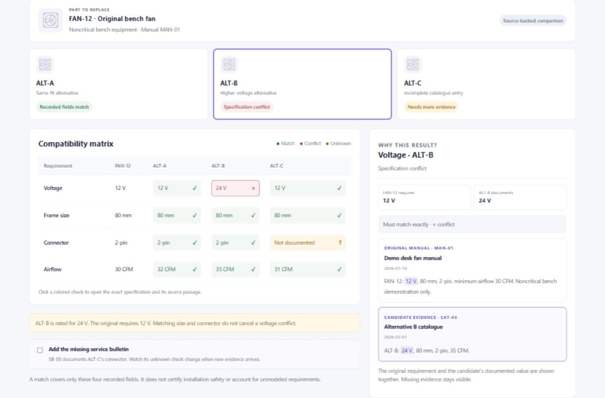

# Spare-Part Investigator v2 — assistant verification

Checked on 2026-11-16.

- 9 Python domain tests passed using temporary repositories.
- JavaScript syntax checks passed for server.mjs and public/app.js.
- Actual Node/Python browser interactions were checked on temporary preview port 3111.
- Tests cover the three verdicts, exact voltage values and citation, unknown connector handling, documented bulletin resolution, minimum-airflow constraints, missing-source handling, valid source IDs, nonmutating read-only comparison, invalid requests, and refusal of installation approval. Browser checks verified ALT-B’s voltage conflict with original and candidate passages, ALT-C’s unknown connector, its change after SB-05 inclusion, and reversal after removing that bulletin. Desktop and narrow layouts were visually checked; the narrow page had equal 600-pixel viewport and document widths.
- Preview servers were stopped after checks. The comparison was restored to its initial no-bulletin state.

These checks establish the stated fictional workflows only. They do not establish real-world compatibility, device safety, repair quality, model reasoning, or production readiness. No live LLM or embedding model is integrated.

## Verified interface

